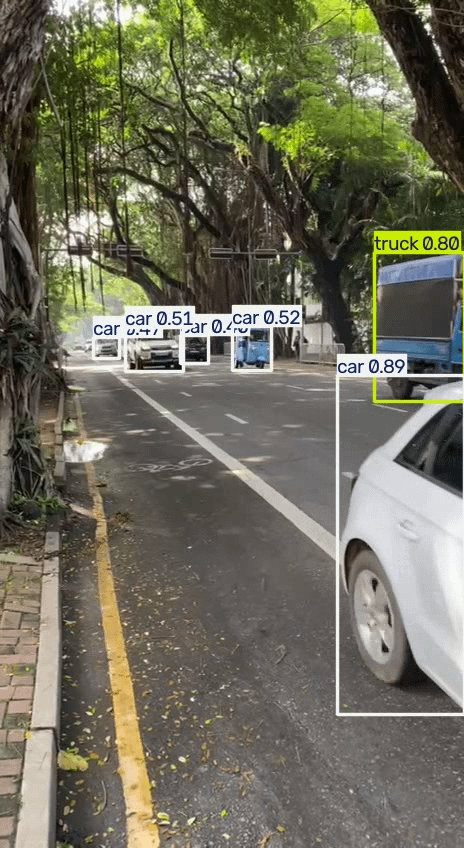

# Video Analytics Platform


Real-time vehicle detection, tracking, counting and traffic forecasting from video.

<!-- Add demo GIF here:  -->

## Status

- [x] Phase 1: Data and baseline (v0.1)
- [ ] Phase 2: Fine-tuned detection
- [ ] Phase 3: Tracking and line-crossing counter
- [ ] Phase 4: Forecasting and anomaly detection
- [ ] Phase 5: API and dashboard
- [ ] Phase 6: Optimization (ONNX) and deployment

## Baseline results (pretrained YOLOv8 on COCO, CPU)

Clip: 726 frames of road traffic recorded on a phone.

| Model | Avg FPS (CPU) | car | truck | bus | person | motorcycle |
|---|---|---|---|---|---|---|
| yolov8n | 7.7 | 2890 | 309 | 233 | 150 | 90 |
| yolov8s | 3.0 | 2859 | 756 | 292 | 195 | 134 |

Counts are per-frame totals, not unique vehicles (tracking comes in Phase 3).
Both models are well below real-time speed on CPU, which motivates the
optimization work planned for Phase 6. More notes in [docs/experiments.md](docs/experiments.md).

## Project structure

```
src/
  data/         frame extraction
  detection/    YOLO baseline (fine-tuning next)
  tracking/     (planned)
  forecasting/  (planned)
  api/          (planned)
tests/          unit tests
docs/           dataset notes and experiment log
```

## Setup

```bash
git clone https://github.com/deshan-maker/video-analytics-platform.git
cd video-analytics-platform
python -m venv .venv
.venv\Scripts\activate        # Windows
pip install -r requirements.txt
```

## Usage

Extract frames from a video:

```bash
python src/data/extract_frames.py --video data/raw/clip_01.mp4 --out data/frames/clip_01 --every 15
```

Run the pretrained YOLO baseline:

```bash
python src/detection/baseline_yolo.py --video data/raw/clip_01.mp4 --model yolov8n.pt
```

Run tests:

```bash
pytest
```

## Data

See [docs/dataset.md](docs/dataset.md) for sources, licenses and download steps.
Datasets and model weights are not stored in this repository.

## Roadmap

Planned work follows the phases listed in Status above. Progress is tracked in
GitHub Issues and the project board.